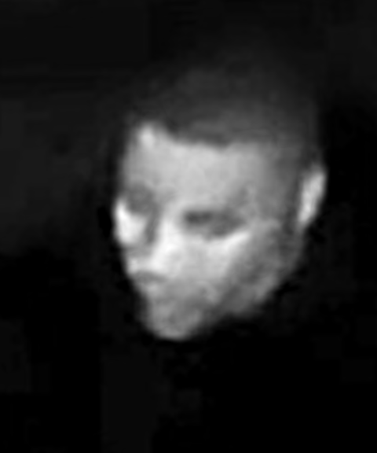
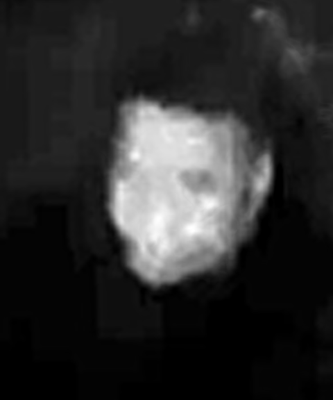

# lieutenant_abeka

Can the face of the thief in the video be shown?

## Answer

**Yes.** `thief_video.mp4` was recorded upside-down because the camera is mounted inverted. Once
the footage is turned the right way up and enhanced, the suspect's face is visible for about 2.5
seconds, at camera clock 01:26:41–01:26:43 on 2026-10-31. During that time they stand at the foot
of the house steps and look up toward the camera.

| Projected frontal face (13 frames) | Looking up at the camera | Head turned | Head slightly lowered |
|:-:|:-:|:-:|:-:|
|  |  |  |  |

All the face pictures are on one sheet in
[output/face/face_pictures.png](output/face/face_pictures.png). The face in every second frame
from 330 to 398 is in [output/face/face_gallery.png](output/face/face_gallery.png), and a stabilised, slowed-down face
close-up is in [output/video/suspect_face_closeup.mp4](output/video/suspect_face_closeup.mp4).

At 01:26:44 the suspect picks up a pair of shoes from the step and walks off with them
([image sequence](output/stills/shoes_taken_sequence.png)).

* **[REPORT.md](REPORT.md)** has the full findings, timeline, description, method and limitations.
* **[output/video/thief_video_enhanced.mp4](output/video/thief_video_enhanced.mp4)** is the whole
  video, corrected and enhanced.
* **[output/suspect_summary.png](output/suspect_summary.png)** is a one-page overview.

The face images come from aligning and averaging several consecutive video frames. No AI
face-generation was used, so they show only what the camera recorded.
