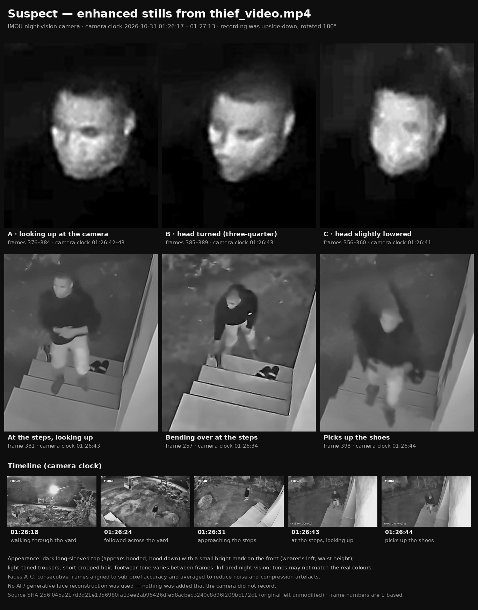
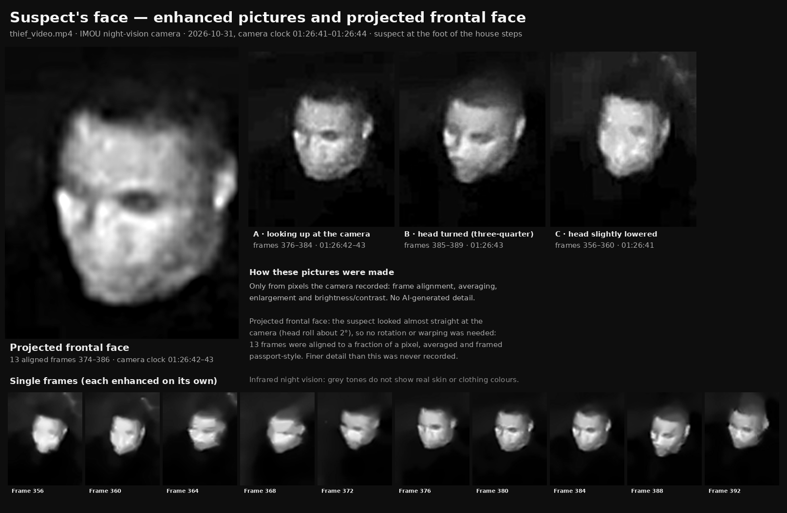
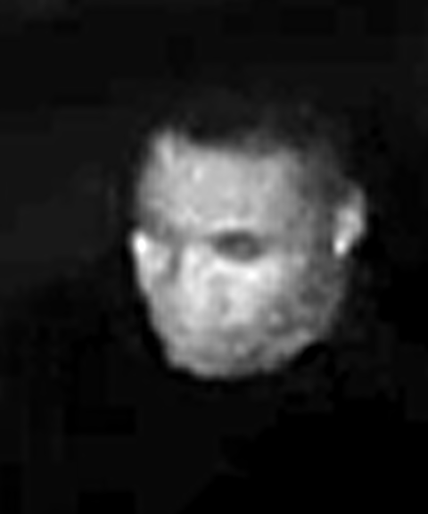
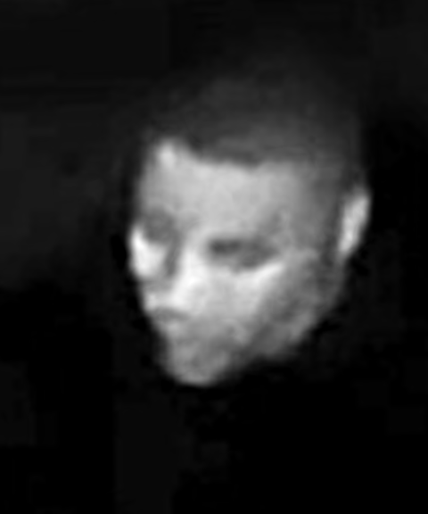
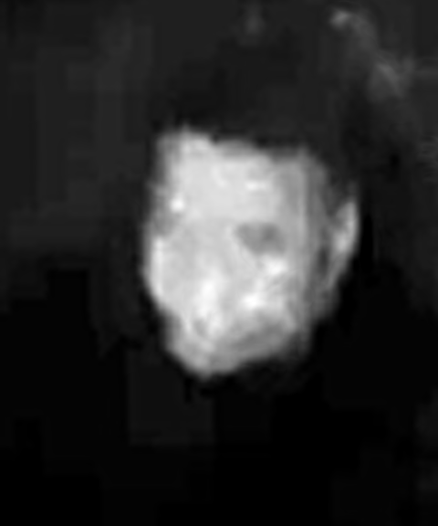
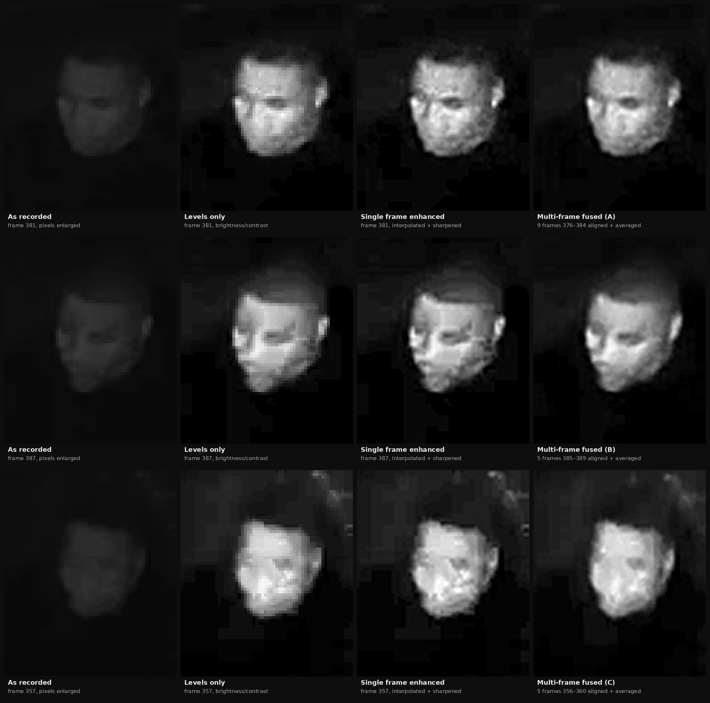
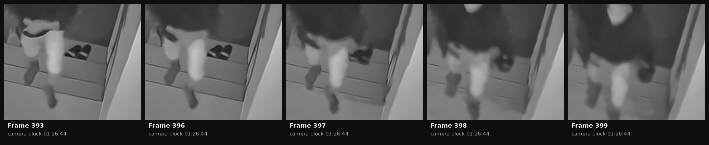

# Enhancement of `thief_video.mp4`: images of the suspect

**Short answer to the README's question: yes.** For about 2.5 seconds (camera clock
**01:26:41 – 01:26:43**) the suspect stands at the foot of the house steps and looks up
toward the camera, and the face can be shown. The best images are below. All of them were
made with classical, traceable image processing; no AI face-generation was used (see §4.5).



## 1. Key images

### Face pictures and projected frontal face



The **projected frontal face**
([`output/face/projected_face_frontal.png`](output/face/projected_face_frontal.png)) is the best
estimate of the face seen straight-on, framed like a passport photo. It was built from the
13 frames (374–386) in which the suspect looks up at the camera, aligned to a fraction of a pixel
and averaged. The suspect was facing the camera almost directly (head roll about 2°), so no
rotation or 3-D warping was needed. See §4.4.

* [`output/face/face_gallery.png`](output/face/face_gallery.png) shows the face in every second
  frame from 330 to 398, each enhanced on its own. Seeing the face in many slightly different
  frames helps people who know the person recognise them.
* [`output/video/suspect_face_closeup.mp4`](output/video/suspect_face_closeup.mp4) keeps the face
  centred (stabilised) at 6× zoom and one-third speed for frames 330–399, about 14 s. Familiar faces
  are recognised more easily in motion.

### Fused face views

| A: looking up at the camera | B: head turned (three-quarter) | C: head slightly lowered |
|:-:|:-:|:-:|
|  |  |  |
| 9 frames fused (376–384) · 01:26:42–43 | 5 frames fused (385–389) · 01:26:43 | 5 frames fused (356–360) · 01:26:41 |

How each face image was built, from the pixels as recorded to the final fused result
(the same brightness mapping is used in every panel):



### The pair of shoes being taken (01:26:44)

A pair of shoes is lying on a step (frames 393 and 396). In frame 397 the suspect's hand grabs
them, and in frames 398–399 the suspect carries them away in their right hand. The step is now empty.



### Enhanced video

* [`output/video/thief_video_enhanced.mp4`](output/video/thief_video_enhanced.mp4) is the whole clip,
  turned the right way up and enhanced, with the original audio. A caption bar shows the frame number
  and the camera's own clock (copied unaltered from the original pixels).
* [`output/video/suspect_closeup_slowmo.mp4`](output/video/suspect_closeup_slowmo.mp4) covers frames
  245–410 (01:26:34 – 01:26:45), the suspect at the steps, at 2× zoom and half speed.

Full-frame stills and zoomed crops for each key moment are in [`output/stills/`](output/stills/).

## 2. What the footage shows

**The recording is upside-down.** The camera (an IMOU pan/tilt night-vision model) is mounted
inverted, for example under an eave, and its image-flip setting is off. Every frame has been
rotated 180°. Only the camera's burned-in clock and logo overlays then appear upside-down.

| Camera clock (2026-10-31) | Frames | What is visible |
|---|---|---|
| 01:26:17 – 01:26:19 | 1 – 30 | The suspect is already in the yard, walking near the wooden kiosk (bottom-left of the corrected picture). |
| 01:26:19 – 01:26:34 | 30 – 252 | The camera pans and tilts to follow the suspect across the yard toward the house. |
| 01:26:34 – 01:26:36 | 253 – 281 | The suspect reaches the house steps and bends over them. A pair of shoes is lying on a step. |
| 01:26:36 – 01:26:40 | 285 – 345 | The suspect crouches at the steps with their head down. The picture becomes very dark here because the camera's auto-exposure reacts to the bright, IR-lit wall. |
| 01:26:41 – 01:26:43 | 356 – 392 | The suspect stands at the foot of the steps and looks up toward the camera. **The face is visible** (views A–C). |
| 01:26:44 | 396 – 399 | The suspect reaches to the step, picks up the pair of shoes and walks off carrying them in their right hand. |
| 01:26:44 – 01:26:46 | 400 – 437 | The suspect leaves the field of view and the camera swings back to its preset view of the yard. |
| 01:26:46 – 01:27:13 | 437 – 839 | Preset yard view. The suspect is not seen again (checked by motion analysis and by eye). |

Frame numbers are 1-based: frame 1 is the first frame of the file. Times are the camera's own
clock, which may not be exactly right.

## 3. Description of the suspect

* A dark, long-sleeved top that appears to be hooded (hood down). It has a small bright,
  infrared-reflective mark on the front, on the wearer's left at about waist height (frames 9, 257,
  269, 341). This could be a logo, a badge or a zip pull.
* Light-toned trousers. The footwear looks light in some yard frames (for example frame 206) but
  mid-to-dark on the steps (frames 381 and 389), so its colour is uncertain.
* Short-cropped hair.
* Under infrared night vision, grey tones do **not** reliably show real colours. Some dark fabrics
  look light in IR, and skin tone cannot be judged. Height and build cannot be measured reliably
  from this steep overhead, wide-angle view.

## 4. Method

### 4.1 Analysis
* The file is 1024×576 H.264 at about 15 fps with 839 frames (55.97 s) and an AAC audio track. It is
  monochrome IR footage, so the luma plane holds all the picture information. All frames were decoded
  with none dropped or duplicated.
* The suspect was located frame by frame, and the clock overlay was read for each key frame.
* The codec structure matters for the face. Frames 357, 372 and 387 are I-frames (key frames, about
  44–50 KB each). Most P-frames in between are only about 1 KB, which means the encoder sent very
  little new detail for them. So the usable face information sits in a few short windows around
  those key frames.

### 4.2 Whole-video enhancement ([`enhancement/enhance_video.py`](enhancement/enhance_video.py))
1. Rotate 180°.
2. **Exposure-adaptive gamma.** Each frame's median brightness, smoothed over about 1 s so it does not
   flicker, sets a gamma between 0.45 and 1.0. This lifts the very dark steps segment (median
   ≈ 19/255) much more than the brighter yard segments (≈ 70–95/255).
3. **Spatio-temporal non-local-means denoising** over 5 consecutive frames. It runs *after* the gamma
   lift, so the averaging can produce in-between grey levels and the lifted shadows do not band. The
   strength scales with the gamma.
4. Mild CLAHE (local contrast) and a mild unsharp mask.
5. A caption bar with the frame number, the timestamp, and the original pixels of the camera clock.
   Nothing in the picture area is painted over.

### 4.3 Face images ([`enhancement/fusion.py`](enhancement/fusion.py), [`enhancement/suspect_images.py`](enhancement/suspect_images.py))
In a single frame the face is only about **27 × 33 pixels**, and its brightness spans only about
45 grey levels. When the head is nearly still for a fraction of a second, the same face is recorded
several times with different noise and slightly different sub-pixel positions. For each view (A, B, C):

1. **Coarse alignment.** Normalised cross-correlation of the face patch gives an integer shift.
2. **Fine alignment.** Affine ECC registration (Evangelidis & Psarakis, 2008) is evaluated only inside
   an elliptical face mask, so the static background cannot pull the result toward "no motion".
   Every fused frame aligned with correlation ρ ≥ 0.985 (threshold 0.97). The per-frame details are
   in [`output/registration_log.txt`](output/registration_log.txt).
3. Each frame is resampled once (bicubic) onto an 8× finer grid in the reference frame's geometry.
4. A **robust per-pixel average** (trimmed mean) reduces noise and compression artefacts.
5. Levels are set with no highlight clipping, followed by gamma 1.1 and a gentle unsharp mask.

### 4.4 Projected frontal face ([`enhancement/face_projection.py`](enhancement/face_projection.py))
Here "projected" means geometric: the face is shown upright, centred and straight-on. The steps are:

1. The 13 frames 374–386, while the suspect looks up at the camera, are registered as in §4.3.
   The lowest ECC correlation is 0.981. Averaging more frames than view A uses gives a cleaner
   result with the same feature definition.
2. The head's roll is measured from the principal axis of the IR-lit face. It is about 2°, and the
   face is turned toward the camera, so the recorded view is already essentially frontal. The image
   is **not** rotated, stretched or 3-D warped, because changing the face's proportions on the basis
   of assumptions could change features that matter for identification.
3. The result is framed 4:5 with the face centred, as in a passport photo. Levels are set as in
   §4.3. A gentle large-radius unsharp mask (2.5 source pixels) makes the eye sockets, nose and mouth
   shading easier to read; it only re-weights detail that is already present.

The gallery and the face close-up follow the face frame by frame. Each frame is cut at the tracked
face position and denoised with its two neighbours (3-frame non-local means). It is then enlarged
(bicubic or Lanczos) and its levels are set.

### 4.5 What was deliberately *not* done
No generative "AI enhancement" was used: no GAN or diffusion face restoration such as GFPGAN or
CodeFormer, and no learned face super-resolution. Those tools do not recover a face. They paint
a plausible one, and they can produce a sharp, convincing face of **the wrong person**. Every pixel
in these images is a resampled, averaged or tone-mapped version of pixels the camera recorded.

For the same reason there is no AI-"projected" photo-realistic face. From about 27×33 pixels,
such an image would mostly be invented: different runs or tools give faces that look like
different people. Circulated as "the thief", it could lead to an innocent person being accused.
If a clear likeness is needed for a public appeal, the police can commission a forensic artist or a
facial composite from witnesses.

## 5. Limitations and recommendations

* **There is a hard limit on detail.** The camera recorded about 27×33 pixels of face under IR
  lighting, with heavy compression. The images are good for investigation, for example recognition
  by someone who knows the person, or comparison with other footage. On their own they are probably
  not enough for a reliable automated face match.
* **Get a better original if you can.** This file is 1024×576 at about 0.87 Mbit/s, which may be the
  app's reduced-quality stream or a re-encoded export. Export the clip directly from the camera's
  microSD card or the IMOU cloud in the highest quality available. A higher-resolution original would
  give a noticeably better face image, and the same scripts can be re-run on it. Also check the
  camera's other recordings from roughly 01:15 to 01:40, and any neighbours' cameras, for further
  views (for example the suspect arriving or leaving).
* **Evidence handling.** The original `thief_video.mp4` was never modified. Its SHA-256 is
  `045a217d3d21e1356980fa13ee2ab95426dfe58acbec3240c8d96f209bc172c1`. Give the police the original
  file together with these images and this report.
* **Be careful about sharing publicly.** A resemblance in a low-resolution night-vision image is not
  proof of identity, and asking the public to identify someone risks harming an innocent look-alike.
  It is safer to let the police handle identification.

## 6. Reproducing the results

Requires Python 3.10+ and ffmpeg 5.1+ on PATH.

```bash
pip install -r enhancement/requirements.txt
```

```bash
bash enhancement/run_all.sh
```

`run_all.sh` runs three scripts, in this order:

1. `suspect_images.py`: faces, stills and summary (about 1 min).
2. `face_projection.py`: projected face, gallery and face close-up (under 1 min). It uses the face
   views from step 1.
3. `enhance_video.py`: the full and close-up videos (about 10–15 min on 4 cores).

Everything is deterministic and written to `output/`.

## 7. Files

| Path | Contents |
|---|---|
| `output/suspect_summary.png` | One-page overview: faces, clothing, timeline |
| `output/face/face_pictures.png` | One sheet: projected frontal face, views A–C, single frames |
| `output/face/projected_face_frontal.png` | Projected frontal face: 13 fused frames, passport framing |
| `output/face/face_gallery.png` | The face in every second frame from 330 to 398 |
| `output/face/face_{A,B,C}_*.png` | Multi-frame fused face images (8× enlargement) |
| `output/face/face_enhancement_steps.png` | Recorded → levels → single frame → fused, for each view |
| `output/stills/frame_NNNN.png` | Full frames, upright and enhanced, with caption bar |
| `output/stills/suspect_frame_NNNN.png` | Zoomed crops of the suspect at each key moment |
| `output/stills/shoes_taken_sequence.png` | Frames 393–399: the shoes being picked up |
| `output/video/thief_video_enhanced.mp4` | Whole clip, upright and enhanced, original audio |
| `output/video/suspect_closeup_slowmo.mp4` | Frames 245–410 at 2× zoom and half speed |
| `output/video/suspect_face_closeup.mp4` | Face-stabilised close-up, frames 330–399, 6× zoom, ⅓ speed |
| `output/registration_log.txt` | Alignment quality of every fused frame |
| `enhancement/*.py` | The processing scripts |
